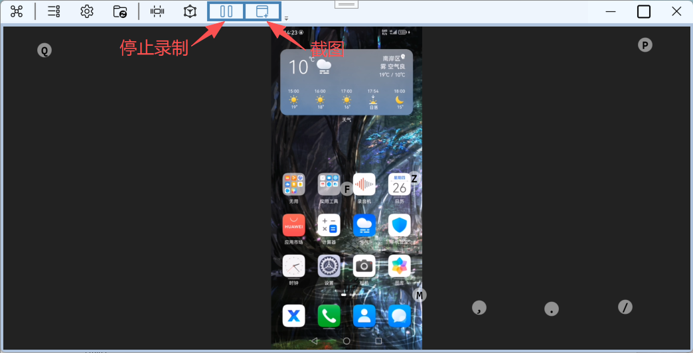
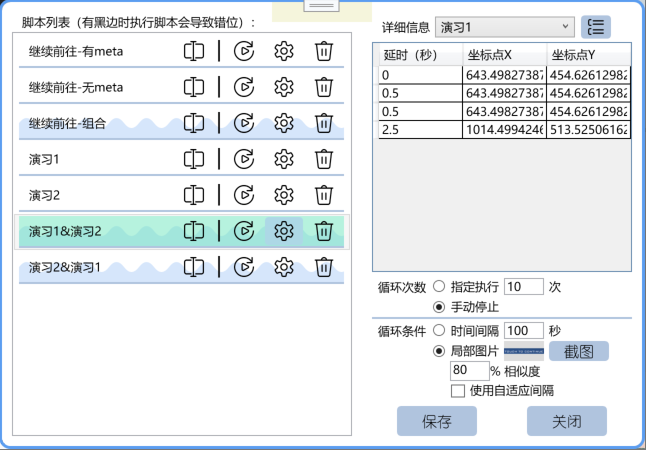

## ScrcpyEX
ScrcpyEX 是 Scrcpy Expand。

基于 scrcpy 的 C# 桌面增强客户端 —— 通过可分离的进程调用方式，为 scrcpy 附加自动化脚本等功能，不修改上游源码。

Releases下载即可运行，首次使用时注意通过手机上的配对提示。

## 核心特性
ScrcpyEX 在保留 scrcpy 轻量、低延迟核心优势的基础上，增加了以下能力：

* 脚本录制功能，并可以在录制过程中进行截图，作为脚本执行的条件。
* 相互传输电脑和手机上指定目录的文件（基于ADB实现）。
* 按键映射为鼠标点击。

## 使用
脚本的录制（快捷键F4）。

脚本可以设置循环次数、循环条件，循环条件为图片时，图片相似度达到指定阈值则执行脚本并且循环次数+1。

将一个脚本拖动到另一个脚本上可以组合成一个新脚本，组脚本有独特背景。

脚本每次点击前可以设置延时。

图像相似度识别使用的算法是SIFT。

## 快捷键
* F1：以有线方式启动scrcpy，需要USB数据线和电脑连接。
* F2：以无线方式启动scrcoy，需要设备和电脑在同一个局域网中。
* F3：关闭scrcpy。
* F4：录制脚本，如果正在录制脚本，则结束录制。
* F5：打开脚本管理界面。
* F6：打开程序设置界面。
* F7：打开定位和大小设置菜单。
* F8：打开功能菜单。
* F9：打开USB网络共享。
* F10：打开数据同步界面。
* F11：输入焦点给到scrcpy，此时右下角会显示一个小图标，再次按下将输入焦点还给主程序。当scrcpy持有焦点的时候，映射按钮不会响应。

## 与 scrcpy 的关系
ScrcpyEX 的主体代码与 scrcpy 可分离，通过进程嵌入交互使用 scrcpy 的能力。

scrcpy 的版权归 Genymobile 所有，遵循 Apache License 2.0。

本项目在分发时附带 scrcpy 的许可证副本（见 LICENSE-scrcpy），并在此致谢上游。

本项目不捆绑 scrcpy 二进制文件。请从 scrcpy Releases 自行获取对应版本，放入指定目录或加入系统 PATH。

## 项目架构
项目采用 .NET Framework 4.8 + WPF ，核心目录结构如下：

ScrcpyEX/
├── Model/            # 数据模型
├── MyDefinition/     # 自定义定义与配置
├── Properties/       # 程序集属性
├── Resource/         # 样式与资源文件
├── View/             # XAML 视图
├── ViewModel/        # 视图模型（业务逻辑）
├── App.xaml          # 应用程序入口
└── ScrcpyEX.csproj   # 项目文件

## 许可证
本项目自身代码采用 Apache License 2.0 许可证（见 LICENSE）。

scrcpy 同样采用 Apache License 2.0（见 LICENSE-scrcpy），版权归 Genymobile 所有。

## 致谢
Genymobile/scrcpy —— 提供强大且轻量的 Android 镜像与控制核心。

## 贡献与反馈
欢迎通过 Issues 反馈问题或提出建议。提交 PR 前，建议先开 Issue 讨论实现思路，以便更高效地合并。

维护说明：个人项目，随缘更新，欢迎 PR。

